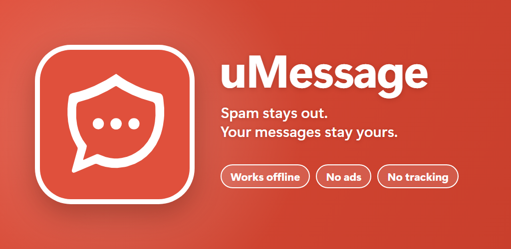
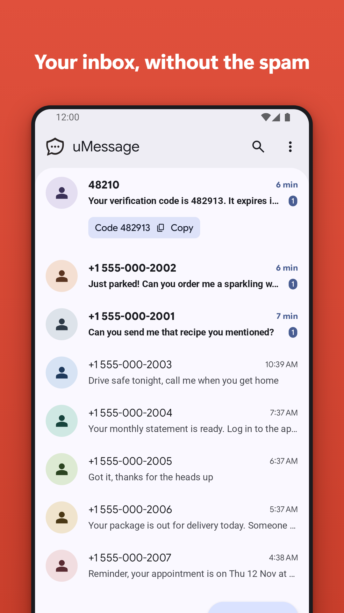
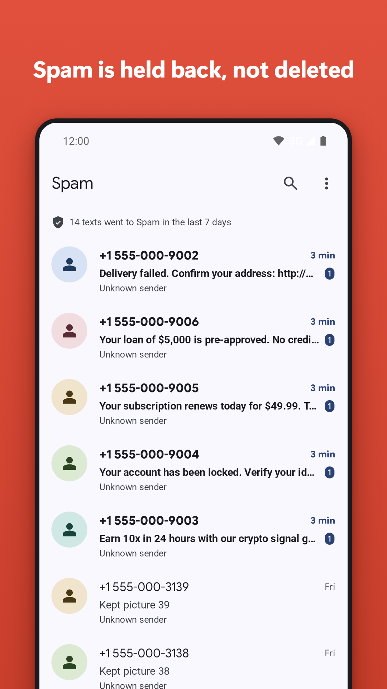
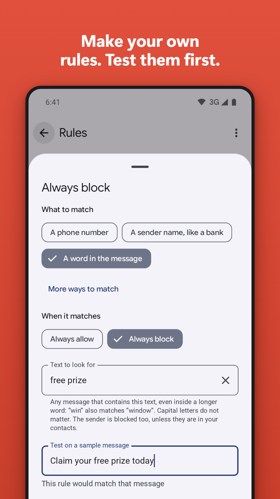
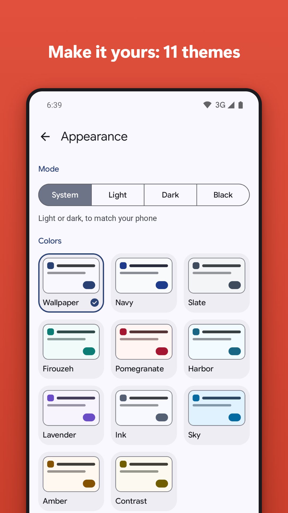

# uMessage

<p align="center"></p>

An Android SMS/MMS app whose main job is to stop spam. uMessage is a full default-SMS-app replacement (Poco, Redmi, Xiaomi, Samsung and any other Android phone) that, out of the box, sorts chats from senders you do not know (not in your contacts, never texted by you) into a Spam list. It has allow and block rules, keyword and regex rules, real dual-SIM support, and it is fully offline: the app does not request the INTERNET permission.

uMessage is a fork of [Fossify Messages](https://github.com/FossifyOrg/Messages) (GPL-3.0).

## Features

- Full SMS and MMS messaging: group threads, search, drafts, scheduled send, recycle bin and archive, private notes on messages, stars and labels (partly inherited from Fossify Messages).
- Long texts go out as a normal multipart SMS by default; Settings > Typing and sending > "Send long texts as picture message (MMS)" can switch to MMS from 2 to 10 SMS parts.
- Backup and restore to a file (Settings > Backup and restore): messages with Spam messages, the recycle bin, drafts, muted and hidden chats, saved texts, scheduled messages, notes, stars, labels and archived chats; rules and settings in a second file. Backup files are not encrypted. A "Save to Google Drive" button hands the backup file to the Google Drive app, which does the upload; uMessage itself never connects to the internet.
- One spam filter switch, on by default. Unknown senders go to a Spam list instead of your inbox, and a verification code from an unknown sender is allowed through. Spam makes no sound. Texts are stored in Android's own SMS store, marked read, so no message is lost if you switch to another SMS app.
- The filter works on the sender, so a chat is always whole, either in Messages or in Spam. Blocking a sender moves the whole chat to Spam, with Undo.
- Block rules support exact number, prefix, alphanumeric sender id (for example `ACME-BANK`), keyword and regex rules. An allow rule you made wins over a block; a block wins over everything automatic. Adding an allowed keyword or pattern warns that any sender who sends it is allowed. A keyword or pattern rule applies to the sender: a blocked keyword also blocks the sender, an allowed keyword also allows the sender (never a contact, and never over a block rule you made yourself).
- Each rule covers both SIMs: one rule per number, not one per SIM.
- Rules can be exported and imported (SIM and note included); an import shows what it will add before anything changes.
- The Spam folder is reversible: "Not spam" restores the messages to the real inbox and adds an allow rule for the sender in one step, with one Undo; names that anyone can fake get no rule. Delete the rule in Settings > Spam protection > Rules to stop allowing a sender. Spam is kept until you delete it: auto-delete is off by default ("Keep forever") and can be set to a number of days.
- Forward rules: send a copy of matching inbox messages (for example bank alerts) by SMS to up to three numbers. See [Forwarding](#forwarding). Optional and off by default.
- Dual SIM: receive and send on either SIM; spam rules cover both.
- A picture message (MMS) in Spam is downloaded like any other when its announced size is known and at most 1 MiB and the phone is not roaming, so it can use a little mobile data. A larger one stays as "Tap to download".
- Light, dark and 11 colour themes, an optional app lock (PIN or fingerprint), a Copy code button on verification codes, and 22 languages (English and 21 more, including Persian, Arabic, Chinese in both scripts and Urdu).
- Private: no analytics, no network access. Spam is kept in the phone's SMS store, which other SMS apps and the phone's SMS backup can read.

## Screenshots

<table>
<tr><td align="center"></td><td align="center"></td><td align="center"></td><td align="center"></td></tr>
</table>

More screenshots are in [`fastlane/metadata/android/en-US/images/phoneScreenshots`](fastlane/metadata/android/en-US/images/phoneScreenshots).

## Install

uMessage is distributed as an APK on the [GitHub Releases](../../releases) page. A Google Play version is in closed testing. The two are signed with different keys, so one cannot update the other: uninstall one before installing the other.

1. On your phone, download the latest `.apk` from Releases.
2. Android blocks the install the first time. Open the prompt's Settings link (or Settings > Apps > Special app access > Install unknown apps), choose your browser or file manager, and enable "Allow from this source". Install the APK; you may turn the option off again afterwards.
3. Open uMessage and follow the first-run setup. The welcome screen has a language chip (pick your language or keep the phone's), the choice for unknown senders, and **Get started**; see step 4. Then comes **Allow**: set uMessage as the default SMS app (Android shows a system dialog; choose uMessage) and grant the permissions (Messages, Contacts, Phone state, Notifications; **Allow all** asks for them at once; each one is explained in [PRIVACY.md](PRIVACY.md)). uMessage can only receive and filter messages while it is the default SMS app.
4. On the welcome screen, choose what happens to unknown senders: **Sort unknown senders into Spam** (recommended) or **Keep everything in Messages**. Two switches sit below it: a quiet notification for each text that goes to Spam (off by default) and a weekly Spam summary (on for new installs). Spam sorting is not always right, so look at Spam once a week. Spam is kept until you delete it unless you turn on auto-delete later.
5. The last step, **Keep uMessage running**: on Xiaomi/Poco/Redmi (HyperOS/MIUI) enable Autostart and set Battery saver to "No restrictions" for uMessage. On Samsung remove uMessage from "Sleeping apps".

## How filtering works

Every incoming SMS is judged by its sender. The first check that decides wins:

1. The sender cannot be read: Messages.
2. An allow rule you made names the sender: Messages. This beats any block.
3. A block rule names the sender (made by you or by a blocked word), or Android's own block list has it: Spam, even if it is a contact.
4. The sender is a contact: Messages. If contacts cannot be read (no permission or a failed lookup), phone numbers go to Messages, so a failure never hides texts from people you know.
5. The text holds one of your allowed words or patterns: Messages, and the sender is allowed from then on. A blocked word or pattern sends the sender to Spam.
6. The sender is on one of the two automatic lists, **People you wrote to** or **Senders of a verification code**: Messages.
7. The spam filter switch is off: Messages.
8. Otherwise the sender is unknown: Spam.

The same answer sorts the chat list, so a chat is never split. The old Smart, Strict and Off modes are gone; the verification code list has its own switch (turning it off gives the old Strict behaviour).

Spam texts are stored in Android's SMS store, marked read and seen, with no sound and no notification unless you turn on the quiet one. Open the Spam tab to review them and tap "Not spam" to move a chat back and allow its sender. Group chats always stay in Messages. Details: [docs/FILTER_PIPELINE.md](docs/FILTER_PIPELINE.md).

Banks, delivery companies and one-time-code services usually message you from numbers that are not contacts. A verification code lets its sender through; for the rest, use "Not spam" once per sender.

## Forwarding

Settings > Forwarding lets you send a copy of incoming messages to other phones by SMS. It is optional, off until you create a rule, runs entirely on the phone, and sends by SMS on your own mobile plan (each forward is a paid SMS). It is the same in every build, Google Play included. A forward rule has:

- **Conditions**: a sender (exact number, prefix or sender id) and/or a text to look for (keyword or regex), read the same way as the filter rules, Persian and Arabic letter forms included. Optionally a time of day (an end before the start runs past midnight) and, on dual-SIM phones, the SIM it arrived on.
- **Targets**: one to three phone numbers, and on dual-SIM phones the SIM to send from (the receiving SIM by default).

A forward reads `[from <contact name or number>] <original text>`. For an MMS only the text is forwarded, followed by `[picture not forwarded]`. Long text goes out as a multipart SMS. **Each forward is a paid SMS.**

Safety:

- Only messages that reached your inbox are forwarded. Spam never is.
- Verification codes are not forwarded unless a rule's "Include verification codes" switch is on, which warns first: forwarding codes lets the recipient sign in to your accounts, and scammers ask people to set this up.
- Loop guard, always on: a message that is itself a forward (it starts with `[from `) is never forwarded, nothing is forwarded back to the number it came from, and messages you send are never forwarded.
- With the app lock on, creating, editing, turning on or deleting a forward rule asks for your PIN, pattern or fingerprint. Without an app lock, uMessage suggests setting one the first time. Turning a rule off never asks.
- Every forward, failed forward and skipped forward is in the decision log (Settings > Spam protection > Recent activity) with the rule, target and result, never the text. A forward that cannot be sent shows the usual "message not sent" notification, and the failed copy stays in the target's thread to resend.
- The **Forwarded** tab (the forward log) appears as soon as you add a forward rule; hide it in Settings > Forwarding.
- An optional **daily forward limit** (Forwarding options; off by default, or 5, 10, 20 or 50 forwards a day): once it is reached, nothing more is forwarded for the rest of the day, the skipped forwards are logged and uMessage shows one notification a day. Each rule also has an hourly cap. There is no notification per forward.

## Limitations

- No RCS. Android gives RCS access only to Google Messages and Samsung's stack; third-party apps cannot send or receive RCS. uMessage handles SMS and MMS only. If messages stop arriving after switching, turn off RCS/chat features in your previous messaging app.
- uMessage filters texts only. Numbers on Android's own block list are also stopped from calling you, because Android applies that list to calls as well.
- MMS behaviour depends on your carrier; see the device checklist.
- Distributed as an APK on GitHub Releases. A Google Play version is in closed testing.
- Translated into 21 languages besides English (including Persian, Arabic and Urdu, right-to-left, and Chinese in Simplified and Traditional). Some translations are machine-made and not yet reviewed by native speakers.

## Privacy

All data stays on your device. The app declares no INTERNET permission, so it cannot send anything off the phone over the network, and CI fails any build that requests it. The only messages it sends are the ones you write and, in every build, the SMS forwards of rules you set up yourself (optional, off by default). Spam is stored in the phone's SMS store, so a phone's SMS backup can include it. See [PRIVACY.md](PRIVACY.md).

## Build from source

Requirements: JDK 17 and Android SDK 36. See [scripts/SETUP.md](scripts/SETUP.md).

```
./gradlew assembleFossDebug          # APK in app/build/outputs/apk/foss/debug/
./gradlew testFossDebugUnitTest      # unit tests
./gradlew lintFossDebug              # lint
./gradlew assembleFossRelease        # minified (R8) release APK, unsigned without a keystore
./gradlew detekt                     # static analysis; CI fails on findings not in the baseline
```

For a signed release build, copy `keystore.properties_sample` to `keystore.properties` and fill it in, or set the `SIGNING_*` environment variables.

More documentation: [User guide](docs/USER_GUIDE.md), [Architecture](docs/ARCHITECTURE.md), [Filter pipeline](docs/FILTER_PIPELINE.md), [Emulator testing](docs/EMULATOR_TESTING.md), [Device test checklist](docs/DEVICE_TEST_CHECKLIST.md), [Releasing](docs/RELEASE.md), [Security](SECURITY.md).

## Credits and license

- Based on [Fossify Messages](https://github.com/FossifyOrg/Messages) by the Fossify contributors, licensed GPL-3.0.
- UI design guidance from the [ui-ux-pro-max](https://github.com/nextlevelbuilder/ui-ux-pro-max-skill) skill (MIT).
- uMessage is licensed under the GNU GPL v3.0. See [LICENSE](LICENSE) and [NOTICE.md](NOTICE.md); font and library license texts are in [licenses/](licenses).
- Source code: https://github.com/MyNameIsGlooboo/uMessage
