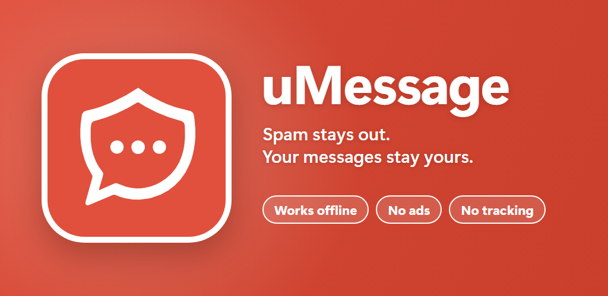
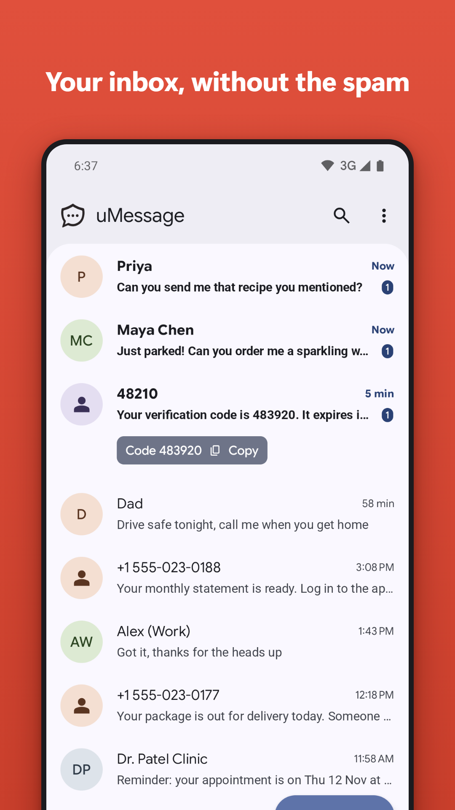
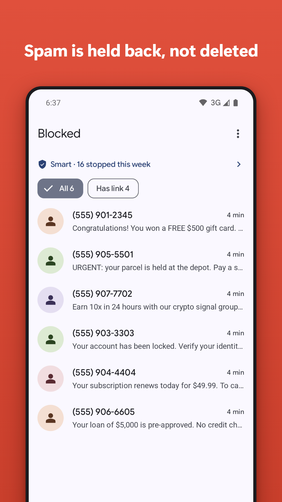
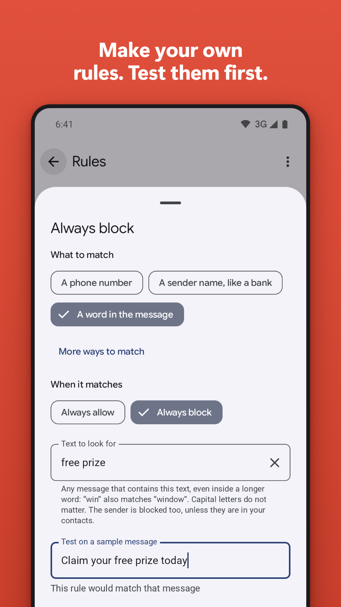
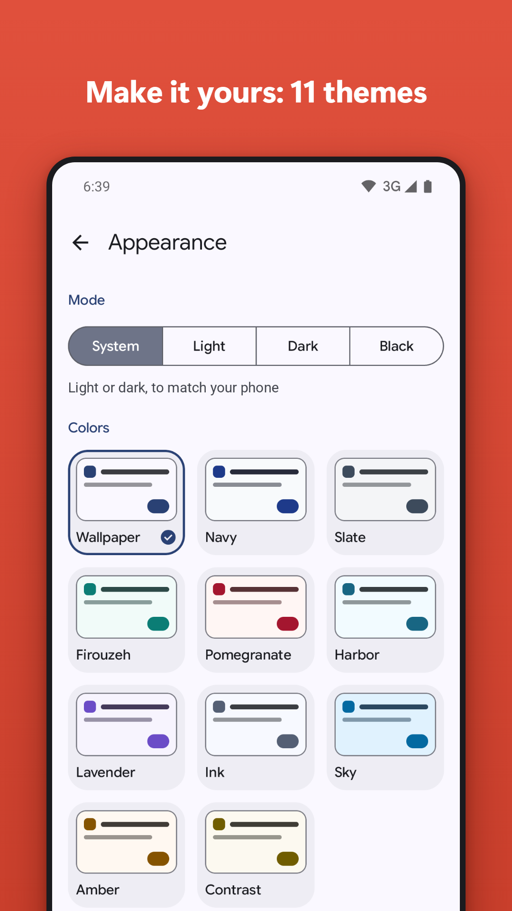

# uMessage

<p align="center"></p>

An Android SMS/MMS app whose main job is to stop spam. uMessage is a full default-SMS-app replacement (Poco, Redmi, Xiaomi, Samsung and any other Android phone) that, out of the box, holds back messages from senders you do not know: not in your contacts and never texted by you. It has a whitelist, a blacklist, keyword and regex rules, real dual-SIM support, and it is fully offline: the app does not request the INTERNET permission.

uMessage is a fork of [Fossify Messages](https://github.com/FossifyOrg/Messages) (GPL-3.0).

## Features

- Full SMS and MMS messaging: group threads, search, drafts, scheduled send, backup and restore (inherited from Fossify Messages).
- Smart mode by default on new installs: messages from unknown senders go to a Blocked folder instead of your inbox, but verification codes without a link still arrive. Strict blocks codes too; Off turns unknown-sender filtering off.
- Allowed rules always win; blocked rules support exact number, prefix, alphanumeric sender id (for example `VM-HDFCBK`), keyword and regex rules. Adding an allowed keyword or pattern warns that any message containing it skips every block.
- Rules can be exported and imported (SIM and note included); an import shows what it will add before anything changes.
- Blocked folder is reversible: "Not spam" restores the message to the real inbox and allows the sender. Blocked messages are purged after 30 days by default (configurable).
- Forward rules: send a copy of matching inbox messages (for example bank alerts) by SMS to up to three numbers. See [Forwarding](#forwarding).
- Dual SIM: receive, send and rules per SIM.
- Blocked MMS are not downloaded, so no mobile data is spent on them.
- Private: all data stays on the device, no analytics, no network access.

## Screenshots

<table>
<tr><td align="center"></td><td align="center"></td><td align="center"></td><td align="center"></td></tr>
</table>

More screenshots are in [`fastlane/metadata/android/en-US/images/phoneScreenshots`](fastlane/metadata/android/en-US/images/phoneScreenshots).

## Install

uMessage is distributed as an APK on the [GitHub Releases](../../releases) page.

1. On your phone, download the latest `.apk` from Releases.
2. Android blocks the install the first time. Open the prompt's Settings link (or Settings > Apps > Special app access > Install unknown apps), choose your browser or file manager, and enable "Allow from this source". Install the APK; you may turn the option off again afterwards.
3. Open uMessage and follow onboarding. Tap "Set as default SMS app" (Android shows a system dialog; choose uMessage). uMessage can only receive and filter messages while it is the default SMS app.
4. Grant the requested permissions (SMS, Contacts, Phone state, Notifications). Each one is explained in [PRIVACY.md](PRIVACY.md).
5. On Xiaomi/Poco/Redmi (HyperOS/MIUI) enable Autostart and set Battery saver to "No restrictions" for uMessage. On Samsung remove uMessage from "Sleeping apps".

## How filtering works

Every incoming SMS passes through these steps, in order, before anything is written to the system inbox. The first step that decides wins:

1. Sender or text matches an allowed rule: deliver. Allowed rules beat every block, so an allowed keyword lets any message that contains it through.
2. Sender or text matches a blocked rule: block.
3. Sender is known (in your contacts, or a number you have sent a text to before): deliver.
4. Otherwise the unknown-sender mode decides:
   - **Smart** (default for new installs): verification codes without a link are delivered, everything else is blocked.
   - **Strict**: blocked, verification codes included. There is no separate code exception.
   - **Off**: delivered. (The old "Block unknown numbers" switch on the Blocked numbers screen only matters here: it makes Off behave like Strict.)

Nothing is held "for review": a message is either delivered or put in the Blocked folder. A message whose sender cannot be read goes to the inbox, and so does any message when the contacts lookup fails or contacts access is missing, so a failure never hides texts from people you know.

Blocked messages are stored only inside uMessage, with no notification unless you turn one on. Open the Blocked folder to review them and tap "Not spam" to restore one. Details: [docs/FILTER_PIPELINE.md](docs/FILTER_PIPELINE.md).

Banks, delivery companies and one-time-code services usually message you from numbers that are not contacts. Smart lets their codes through; for the rest, use "Not spam" once per sender. In Strict mode their codes are blocked too.

## Forwarding

Rules > Forward lets you send a copy of incoming messages to other phones by SMS. A forward rule has:

- **Conditions**: a sender (exact number, prefix or sender id) and/or a text to look for (keyword or regex), read the same way as the filter rules, Persian and Arabic letter forms included. Optionally a time of day (an end before the start runs past midnight) and, on dual-SIM phones, the SIM it arrived on.
- **Targets**: one to three phone numbers, and on dual-SIM phones the SIM to send from (the receiving SIM by default).

A forward reads `[from <contact name or number>] <original text>`. For an MMS only the text is forwarded, followed by `[picture not forwarded]`. Long text goes out as a multipart SMS. **Each forward is a paid SMS.**

Safety:

- Only messages that reached your inbox are forwarded. Blocked spam never is.
- Verification codes are not forwarded unless a rule's "Include verification codes" switch is on, which warns first: forwarding codes lets the recipient sign in to your accounts, and scammers ask people to set this up.
- Loop guard, always on: a message that is itself a forward (it starts with `[from `) is never forwarded, nothing is forwarded back to the number it came from, and messages you send are never forwarded.
- With the app lock on, creating, editing, turning on or deleting a forward rule asks for your PIN, pattern or fingerprint. Without an app lock, uMessage suggests setting one the first time. Turning a rule off never asks.
- Every forward, failed forward and skipped forward is in the decision log (Settings > Decision log) with the rule, target and result, never the text. A forward that cannot be sent shows the usual "message not sent" notification, and the failed copy stays in the target's thread to resend.
- There is no daily limit and no notification per forward.

## Limitations

- No RCS. Android gives RCS access only to Google Messages and Samsung's stack; third-party apps cannot send or receive RCS. uMessage handles SMS and MMS only. If messages stop arriving after switching, turn off RCS/chat features in your previous messaging app.
- Calls are not blocked (SMS only).
- MMS behaviour depends on your carrier; see the device checklist.
- Distributed as an APK only for now (not Google Play).
- English only.

## Privacy

All data stays on your device. The app declares no INTERNET permission, so it cannot send anything off the phone over the network, and CI fails any build that requests it. The only messages it sends are the ones you write and the SMS forwards of rules you set up. See [PRIVACY.md](PRIVACY.md).

## Build from source

Requirements: JDK 17 and Android SDK 36. See [scripts/SETUP.md](scripts/SETUP.md).

```
./gradlew assembleFossDebug          # APK in app/build/outputs/apk/foss/debug/
./gradlew testFossDebugUnitTest      # unit tests
./gradlew lintFossDebug              # lint
./gradlew assembleFossRelease        # minified (R8) release APK, unsigned without a keystore
./gradlew detekt                     # static analysis; CI fails on findings not in the baseline
```

For a signed release build, copy `keystore.properties_sample` to `keystore.properties` and fill it in, or set the `SIGNING_*` environment variables.

More documentation: [User guide](docs/USER_GUIDE.md), [Architecture](docs/ARCHITECTURE.md), [Filter pipeline](docs/FILTER_PIPELINE.md), [Emulator testing](docs/EMULATOR_TESTING.md), [Device test checklist](docs/DEVICE_TEST_CHECKLIST.md), [Releasing](docs/RELEASE.md), [Security](SECURITY.md).

## Credits and license

- Based on [Fossify Messages](https://github.com/FossifyOrg/Messages) by the Fossify contributors, licensed GPL-3.0.
- UI design guidance from the [ui-ux-pro-max](https://github.com/nextlevelbuilder/ui-ux-pro-max-skill) skill (MIT).
- uMessage is licensed under the GNU GPL v3.0. See [LICENSE](LICENSE) and [NOTICE.md](NOTICE.md); font and library license texts are in [licenses/](licenses).
- Source code: https://github.com/MyNameIsGlooboo/uMessage
